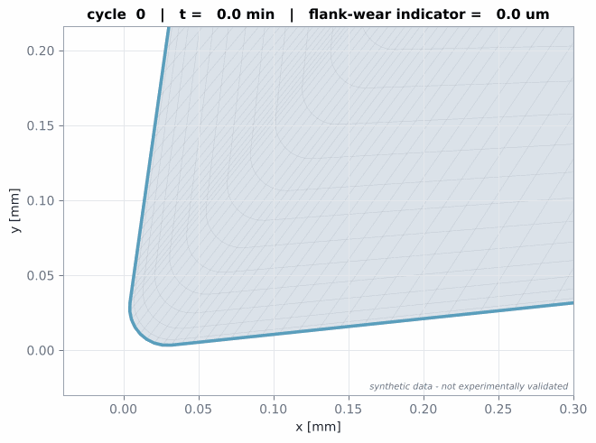
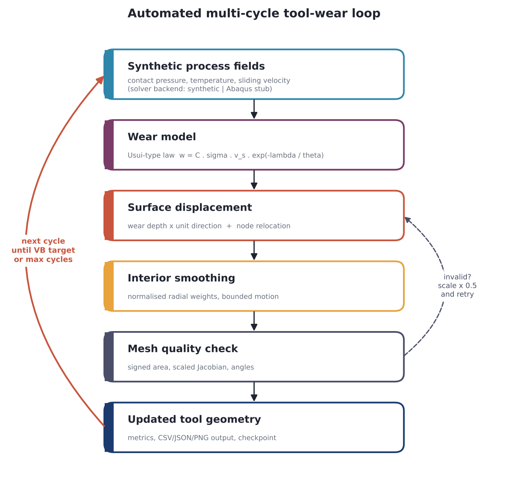
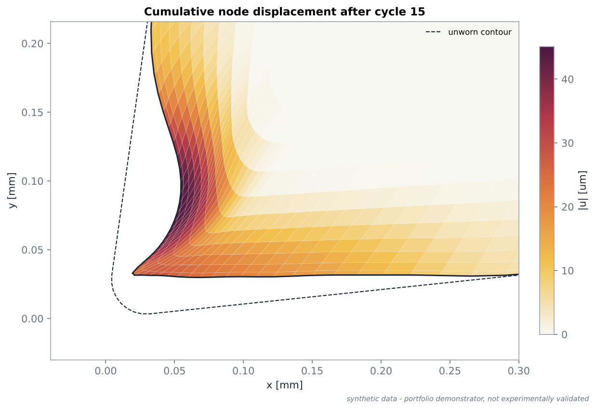
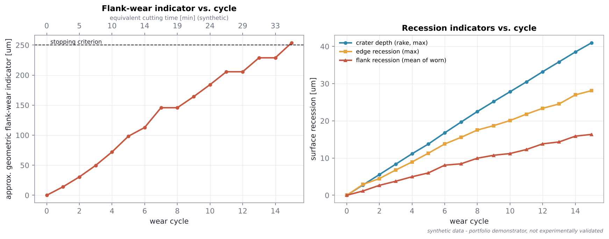

# Synthetic Multi-Cycle Tool-Wear Simulation Framework

[](https://github.com/satagniray/synthetic-tool-wear-fem-framework/actions/workflows/tests.yml)


> A Python-based engineering demonstrator that automates cycle-by-cycle tool-wear prediction using synthetic machining fields, a literature-based wear model, geometry updates, mesh-quality checks, and reproducible result generation.



*15 automated wear cycles on a 2D orthogonal-cutting tool: a crater forms on the rake face and a flat wear land grows on the flank until the flank-wear criterion stops the loop. Synthetic data, solver-free, runs in about 30 s.*

---

## Why this project

* **Tool wear decides machining quality and process stability.** As the cutting edge wears, forces, temperatures, surface finish and dimensional accuracy drift.
* **Wear experiments are expensive.** Every data point costs tools, material and machine time.
* **FEM can predict wear - but only incrementally.** The geometry must be updated cycle by cycle (simulate → extract contact fields → compute wear → move nodes → repair mesh → re-simulate). Done by hand this does not scale; automated, it becomes a tool for virtual process development.

This repository implements that automated loop end-to-end in standard Python. The process fields come from a pluggable backend; the default backend is **synthetic and solver-free**, so anyone can clone, run and inspect the full workflow without a commercial FEM licence.

## What it demonstrates

| | |
|---|---|
| **Python engineering automation** | config-driven multi-cycle loop, CLI, per-cycle outputs, checkpoint / resume |
| **Numerical workflow orchestration** | solver → fields → wear → geometry → solver, with retry-on-failure step control |
| **Mesh processing** | boundary extraction from connectivity, contour normals, node relocation, bounded interior smoothing, Jacobian-based quality checks |
| **Manufacturing process understanding** | orthogonal cutting, Usui-type wear law, crater vs. flank wear, VB-type indicator |
| **Reusable software architecture** | physics, geometry, numerics and solver backend separated behind small interfaces |
| **Testing and reproducibility** | 74 tests, GitHub Actions on Python 3.11/3.12, seeded data, resumed run = uninterrupted run |

## Workflow



## Architecture

```text
src/tool_wear_demo/
├── core/            Mesh, ToolContour, MeshQualityChecker, state containers
├── physics/         synthetic fields, Usui wear law, wear directions
├── displacement/    surface update, node relocation, interior smoothing
├── backends/        SolverBackend protocol · SyntheticBackend · Abaqus stub
├── workflow/        CycleRunner, WearLoop, checkpoints, metrics
├── io/              YAML config, CSV, run folders
├── visualization/   figures, GIF, HTML dashboard
└── cli.py           run · plot · validate · generate-demo-data
```

Details: [docs/architecture.md](docs/architecture.md)

## Installation

```bash
git clone https://github.com/satagniray/synthetic-tool-wear-fem-framework.git
cd synthetic-tool-wear-fem-framework
pip install -e .            # numpy, matplotlib, pyyaml
pip install pytest          # optional, for the test suite
```

## Quick start

```bash
python examples/run_multicycle_demo.py          # full demo (~30 s) -> results/run_<timestamp>/
python examples/run_multicycle_demo.py --fast   # coarse mesh, a few seconds
```

Command-line interface:

```bash
python -m tool_wear_demo.cli run --config config/default.yaml
python -m tool_wear_demo.cli run --config config/demo_fast.yaml
python -m tool_wear_demo.cli run --resume results/run_20261011_120000   # continue from checkpoint
python -m tool_wear_demo.cli plot results/latest                        # rebuild figures + dashboard
python -m tool_wear_demo.cli validate                                   # self-check
python -m tool_wear_demo.cli generate-demo-data                         # data/synthetic/*.csv
pytest -q
```

Every run writes `config_used.yaml`, `history.csv`, a checkpoint, `cycle_###/` folders (nodes before/after, process fields, wear rates, displacements, mesh quality, summary, PNGs) and `figures/` with all plots, the GIF and an interactive `dashboard.html`.

## Example outputs

| Initial tool and graded mesh | Synthetic process fields and wear rate |
|---|---|
|  |  |
| **Tool-contour progression** | **Cumulative node displacement** |
|  |  |



Default run: 15 cycles, ≈ 36 min equivalent cutting time, flank-wear indicator 254 µm (stopping criterion 250 µm), crater depth 41 µm, minimum scaled Jacobian 0.19, no step reductions needed.

An interactive version (cycle slider, geometry, fields, wear-rate distribution, cumulative wear) is in [`docs/dashboard.html`](docs/dashboard.html) - download and open it in a browser. A 7-slide technical overview is in [`docs/project_overview.pdf`](docs/project_overview.pdf).

## Methodology

* **Synthetic fields.** Contact pressure peaks at the edge, temperature peaks behind it on the rake face, sliding velocity is zero at the stagnation point and reaches the cutting speed on the flank. Flank contact is geometric (elastic-recovery gap above the lowest contour point), so the contact land grows as the flank wears flat. → [docs/synthetic_data.md](docs/synthetic_data.md)
* **Usui-type wear law.** `w_dot = C · σ_n · v_s · exp(−λ/θ)` (Xie et al., 2005). Illustrative demo constants by default; literature reference constants available but flagged for unit verification.
* **Geometry update.** Wear depth along the recession direction (rake: surface normal; flank: perpendicular to the cutting velocity; edge: blended), followed by tangential node relocation along the worn profile to keep edge elements from collapsing.
* **Interior smoothing.** Normalised, tapered inverse-distance weights with a smooth decay - a convex combination, so interior nodes never move further than the surface (`|u| ≤ max |u_surface|`).
* **Mesh checks.** Signed area and scaled corner Jacobians; on failure the step is halved and retried, and the loop stops cleanly rather than produce an inverted mesh.

Full write-up: [docs/methodology.md](docs/methodology.md)

## Validation

> This is a portfolio demonstrator using synthetic inputs and is **not experimentally validated**.

The software behaviour is verified by 74 automated tests (wear-law properties, contour orientation, bounded smoothing, quality checks, retry logic, monotonic wear, deterministic resume, ...). Qualitative plausibility and the steps a real validation would need are listed in [docs/validation.md](docs/validation.md).

## Literature

Xie, L.-J., Schmidt, J., Schmidt, C., Biesinger, F. (2005). *2D FEM estimate of tool wear in turning operation.* **Wear 258**, 1479–1490.

## IP / confidentiality statement

This repository is an independently developed portfolio demonstrator inspired by publicly available literature on FEM-based tool-wear prediction. It is not an official RWTH Aachen University or MTI repository. It contains no confidential institute, partner-company, unpublished research, or proprietary project data/code. All geometry, process inputs, datasets, and example outputs are synthetic or independently generated for demonstration purposes. See [docs/ip_and_data_disclaimer.md](docs/ip_and_data_disclaimer.md).

## Rebuilding the documentation assets

```bash
python scripts/build_docs_assets.py     # re-runs the default case, refreshes docs/images, dashboard and PDF
```

## License

MIT - see [LICENSE](LICENSE).
