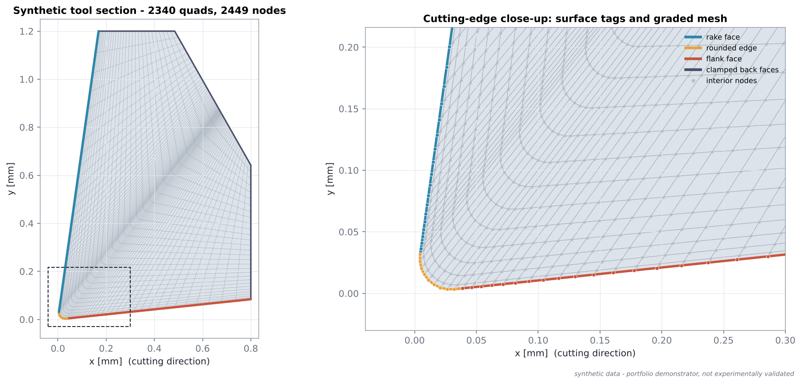
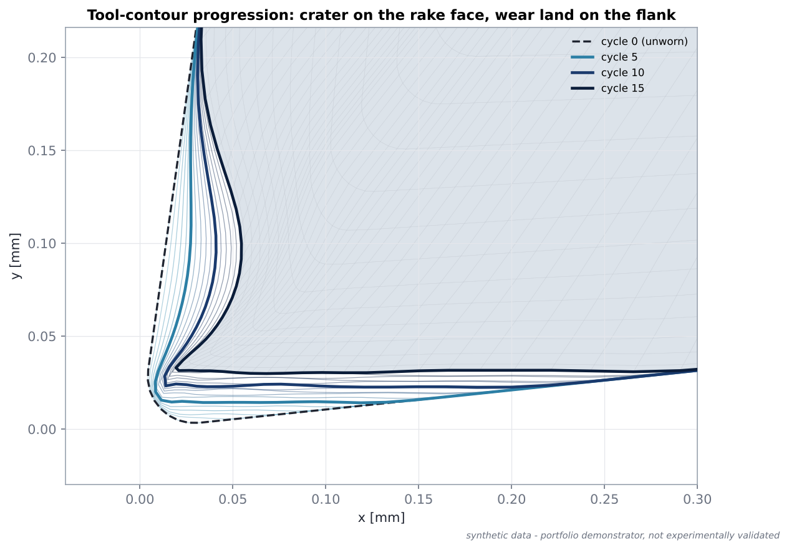

# Methodology

This page explains the engineering ideas behind the demonstrator. It is written
from scratch for this repository and refers only to public literature.

## 1. Orthogonal cutting

In orthogonal cutting the cutting edge is perpendicular to the cutting
velocity, so the process can be studied in a 2D section. The tool has two
active faces that meet at a slightly rounded cutting edge:

* the **rake face**, over which the chip flows away, and
* the **flank face**, which faces the freshly machined surface, inclined to it
  by a small clearance angle.

Material is sheared off ahead of the edge, slides up the rake face as a chip,
and the new surface springs back slightly and rubs along the flank.



The demonstrator uses a generic insert section (rake angle 8°, clearance 6°,
edge radius 25 µm, 0.8 × 1.2 mm body with a chamfered back corner). The back
faces are treated as clamped and never move.

## 2. Why pressure, temperature and sliding velocity matter

Tool wear at cutting temperatures is dominated by abrasion and
temperature-activated (diffusion/chemical) mechanisms. Locally it scales with

* the **normal contact pressure** pushing chip/workpiece against the tool,
* the **sliding distance per unit time**, i.e. the relative sliding velocity,
* an **Arrhenius-type temperature factor**.

A coupled thermo-mechanical cutting simulation delivers exactly these three
quantities on the tool surface. Here they are produced by the synthetic backend
(section 6).

## 3. Wear law

The Usui-type wear-rate law, as used for FEM-based tool-wear estimation by
Xie et al. (2005), is

```text
w_dot = C · σ_n · v_s · exp(−λ / θ)
```

| Symbol | Meaning | Unit in this package |
|---|---|---|
| `w_dot` | wear rate normal to the tool surface | mm/s |
| `σ_n` | normal contact pressure | MPa |
| `v_s` | relative sliding velocity | m/s |
| `θ` | absolute interface temperature | K |
| `C`, `λ` | constants of the tool/work material pair | (mm/s)/(MPa·m/s), K |

Two parameter sets are provided:

* `SyntheticDemoParameters` (default, `wear.model: usui_demo`):
  `C = 3·10⁻⁷`, `λ = 2500 K`. Illustrative only, chosen to give a few
  micrometres of wear per simulated minute with the synthetic fields.
* `UsuiPublishedParameters` (`wear.model: usui_published`): the two-regime
  constants for an uncoated carbide / carbon-steel pair that are commonly quoted
  in the FEM tool-wear literature following Usui and used by Xie et al. Unit
  conventions for `C` differ between secondary sources, so they are flagged
  `verified_for_quantitative_use = False` and must be checked against the
  original papers before any quantitative use.

## 4. Iterative geometry update

Wear changes the geometry, the geometry changes the contact conditions, and
those change the wear. FEM wear prediction therefore advances in **cycles**:

1. obtain the process fields for the current geometry;
2. evaluate the wear rate at each wear-surface node;
3. choose a cycle duration `Δt` and compute the wear depth `w = w_dot · Δt`;
4. move each surface node by `w` in its wear direction;
5. propagate the motion into the interior;
6. check the mesh; if invalid, halve the step and retry;
7. record metrics and outputs, then start the next cycle.

**Cycle duration.** With `time_step_mode: auto_scaled`, `Δt` is chosen so that
the largest nodal wear increment equals `target_max_surface_displacement_um`
(4 µm by default). This is a *numerical step-size control* - analogous to
limiting the geometry change between two FEM re-solves - and not a physical
calibration. The accumulated `Δt` is reported as an "equivalent cutting time".
`time_step_mode: fixed` uses `delta_t_s` instead.

**Increment filtering.** Node-to-node oscillation in the wear increment (from
noisy contact output) would roughen the worn profile and crush thin elements.
A light binomial `[1, 2, 1]/4` filter is applied along the contour
(`wear.depth_smoothing_passes`, default 2).

**Wear directions.**

| Surface | Direction |
|---|---|
| rake face | local inward surface normal (forms the crater) |
| flank face | perpendicular to the cutting velocity (`flank_direction: cutting_normal`), which produces the flat flank wear land observed in practice; `surface_normal` is available as an alternative |
| rounded edge | blend from the flank direction to the local inward normal along the edge |

Every direction is checked to point into the tool.

**Tangential node relocation.** Moving the nodes of a convex edge inward
pushes them towards each other, and after a few cycles the elements at the edge
collapse. After the wear step the worn profile is kept, but the nodes are slid
*along* it back to their original normalised arc-length positions (with the two
fixed boundary nodes as anchors). Shape and removed material are unchanged; the
node spacing is restored. This is the same idea as surface-node relocation in
ALE-type remeshing.

**Interior smoothing (default: normalised radial).** For an interior node with
distances `d_i` to the surface nodes:

```text
w_i = ( max(0, 1 − d_i / R) / d_i )²
u   = decay(d_min / R) · Σ w_i u_i / Σ w_i
decay(ξ) = 1 − 3ξ² + 2ξ³   (ξ clipped to [0, 1])
```

* The **normalised** average is a convex combination of the surface motions, so
  overlapping neighbourhoods never add up - the interior can never move further
  than the largest surface node (`|u| ≤ max |u_i|`, tested).
* The **tapered inverse-distance** weight makes nodes just beneath the surface
  follow their nearest surface nodes, so thin graded layers are not crushed.
* The smooth **decay** factor fades the motion to zero at radius `R` (80 µm).

An optional `LaplacianSmoother` (harmonic extension by Jacobi iteration with
fixed back faces) is included for comparison. On this strongly graded mesh the
unweighted graph Laplacian performs worse (it ignores element size), which is
why the radial method is the default.

**Mesh quality.** For every quad the signed area and the four corner Jacobians
are computed. A cycle is accepted only if no element is inverted or folded and
the minimum scaled Jacobian (sine of the worst corner angle) stays above
`quality.min_scaled_jacobian` (0.05). Otherwise the displacement is scaled by
`retry_scale` (0.5) and the step retried, up to `max_retries` times; if no
acceptable step exists the loop stops with `mesh_quality_limit` instead of
producing a broken mesh.

## 5. Multi-cycle wear progression

The loop stops when the flank-wear indicator reaches `target_flank_wear_mm` or
after `max_cycles`. In the default run (15 cycles, ≈36 min equivalent cutting
time) a crater forms on the rake face behind the edge, where the synthetic
temperature peaks, and a flat wear land grows along the flank:



**Flank-wear indicator.** Horizontal extent (along the cutting direction) of
the worn flank-side region - original contour points with recession larger than
`vb_threshold_um` - measured from the lowest point of the unworn edge. It is an
*approximate geometric flank-wear indicator*, not an ISO 3685 VB measurement.
Other recorded metrics: maximum recession, crater-depth indicator (maximum rake
recession), edge recession, mean rake/flank recession and removed area.
Recession is measured as the distance from each original contour point to the
current worn profile, so the tangential node relocation does not distort it.

## 6. Synthetic-data approach

The process fields are smooth analytical functions of the signed arc length
`d` from the middle of the rounded edge (see [synthetic_data.md](synthetic_data.md)).
They reproduce the qualitative picture from the cutting literature - pressure
peak near the edge, temperature peak on the rake face, stagnation point at the
edge, flank rubbing at cutting speed - and include one genuine geometry coupling:
flank contact is determined by an elastic-recovery gap above the current lowest
contour point, so the contact land widens as the flank wears flat.

## 7. Limitations

* No FEM solution: the process fields do not respond to the changed geometry
  except through the geometric flank-contact rule.
* 2D plane section; no 3D edge effects, no chip-breaker geometry.
* Demo wear constants and auto-scaled `Δt`: absolute wear values and times are
  illustrative, not predictions.
* No re-meshing: the mesh is moved, not regenerated. The quality guard stops the
  run before elements degenerate; very long runs would need re-meshing.
* No coating, no thermal softening of the tool, no chipping or plastic
  deformation of the edge.

## Reference

Xie, L.-J., Schmidt, J., Schmidt, C., Biesinger, F. (2005). *2D FEM estimate of
tool wear in turning operation.* Wear 258, 1479–1490.
