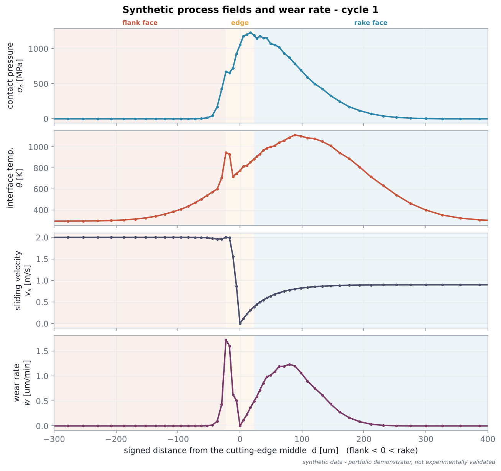

# Synthetic data

**All process inputs in this repository are synthetic.** They are generated by
`tool_wear_demo.physics.synthetic_fields` at run time and are not measured,
calibrated, or taken from any FEM simulation, institute, company or
unpublished research.

## Field definitions

All fields are evaluated on the wear-contour nodes as functions of the signed
arc length `d` (mm) from the middle of the rounded edge (flank `d < 0`, rake
`d > 0`) and of the current node heights.

**Flank contact indicator** - nodes whose height above the current lowest
contour point is smaller than an elastic-recovery gap `g` rub on the machined
surface:

```text
c = clip(1 − (y − y_min) / g, 0, 1)            g = flank_contact_gap_um (2 µm)
```

**Contact pressure** - asymmetric Gaussian centred close to the edge, wide on
the rake face, narrow on the flank, zero beyond the chip contact length, plus a
flank-land contribution:

```text
σ_n = p_max · max( exp(−((d − d_p)/w(d))²) · [d ≤ l_c] ,  r_p · c )
w(d) = w_rake for d ≥ d_p, else w_flank
```

**Interface temperature** - peak on the rake face behind the edge (crater
zone) plus frictional heating of the flank land:

```text
θ = θ_amb + (θ_peak − θ_amb) · max( exp(−((d − d_T)/w_T)²) ,  r_T · c )
```

**Sliding velocity** - zero at the stagnation point, rising to the chip speed
on the rake face (sticking → sliding) and to the cutting speed on the flank;
nodes in flank contact slide at the cutting speed:

```text
v_rake  = v_chip · (1 − exp(−d / l_stick))                 (d ≥ 0)
v_flank = v_c    · (1 − exp( d / l_flank))                 (d < 0)
v_s     = v_profile + c · (v_c − v_profile)
```

**Noise** - seeded multiplicative noise on pressure (`noise_fraction`, 2 %) and
on the temperature rise (half of that). The generator is seeded with
`(project.seed, cycle)`.

## Default parameters

| Key | Value | Meaning |
|---|---|---|
| `max_contact_pressure_MPa` | 1200 | `p_max` |
| `pressure_center_mm` | 0.01 | `d_p` |
| `pressure_width_rake_mm` / `_flank_mm` | 0.12 / 0.03 | Gaussian widths |
| `rake_contact_length_mm` | 0.30 | `l_c`, tool-chip contact length |
| `ambient_temperature_K` / `peak_temperature_K` | 293.15 / 1100 | `θ_amb`, `θ_peak` |
| `temperature_center_mm` / `_width_mm` | 0.10 / 0.14 | `d_T`, `w_T` |
| `cutting_speed_m_per_min` | 120 | `v_c` |
| `chip_speed_ratio` | 0.45 | `v_chip / v_c` |
| `sticking_length_mm` | 0.04 | `l_stick` |
| `flank_sliding_transition_mm` | 0.01 | `l_flank` |
| `flank_pressure_ratio` / `flank_temperature_ratio` | 0.55 / 0.80 | `r_p`, `r_T` |
| `flank_contact_gap_um` | 2.0 | `g` |
| `noise_fraction` | 0.02 | noise level |

These numbers are of a plausible order of magnitude for steel cutting with an
uncoated carbide tool, but they are **demonstration values**.

## Example dataset

`data/synthetic/example_process_fields.csv` (+ `.meta.yaml`) holds the fields
of cycle 1 on the unworn default tool. Regenerate it with

```bash
python -m tool_wear_demo.cli generate-demo-data
```


